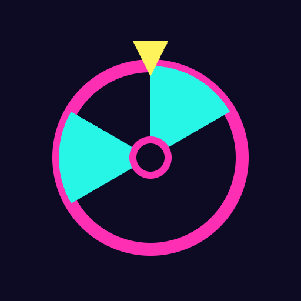

# Neon Spin

Spin. Laugh. Repeat. A neon prompt wheel for family fun.

- ▶ **Try it:** https://atsushikaneko.github.io/neon-spin/
- 📄 **Pitch deck (PDF):** [pitch.pdf](pitch.pdf)

## About

### Family time needs a spark

Playing with friends or family is fun, but it can be hard to think of what to say or do. Neon Spin gives you a prompt with one tap.

- Made for time with friends and family
- The core is a prompt roulette
- Tap the wheel and get a fun prompt
- A glowing neon look on a dark background

### Tap, spin, and play

Spin the wheel and a prompt appears. Then add your own prompts for jokes only your family knows.

- Tap the wheel or the SPIN button to spin it
- Five colors: Talk, Act, Memory, Wish, Ours
- The last 5 prompts are shown as a history
- Add or delete prompts in the Our prompts tab

### Your own prompts, your own fun

Your family's prompts make every spin feel personal. They are saved in your browser, and you can switch between Japanese and English.

- Your prompts stay in this browser only
- You can restore the starter prompts anytime
- Switch between Japanese and English with one button
- Next: an optional finishing touch is still being discussed

## How it was made

Built by shaping the idea together with AI (Claude) and publishing the AI-written code.
The full conversation is in [IDEA.md](IDEA.md) (Japanese).

## Files

- `index.html` — the app (a single self-contained file)
- `IDEA.md` — the idea log
- `pitch.pdf` — the pitch deck
- `assets/logo.png` — the logo
